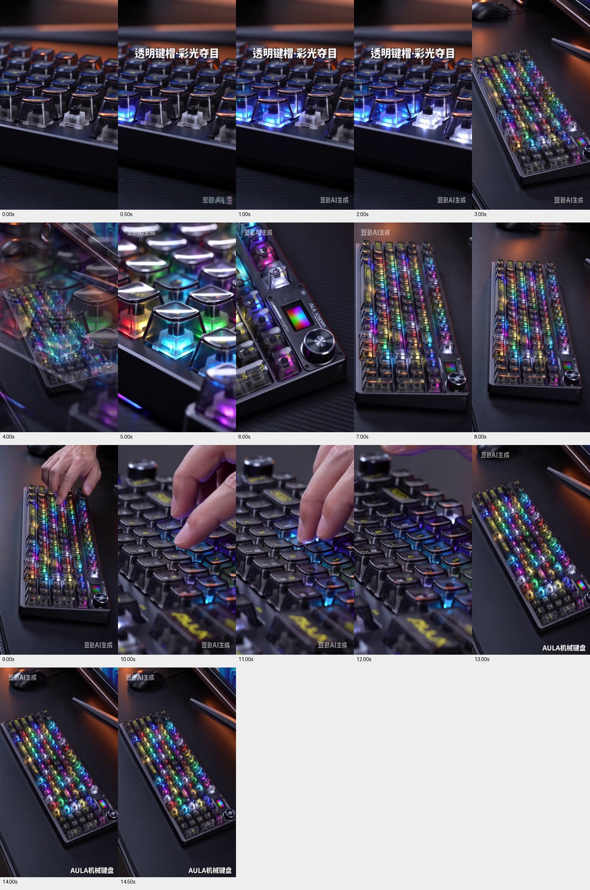
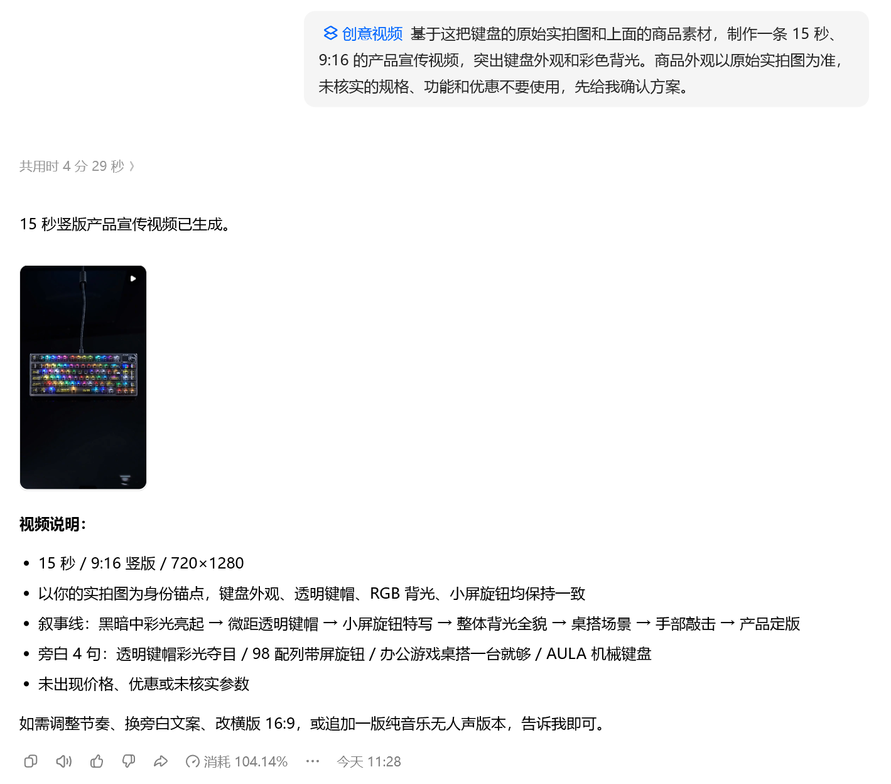
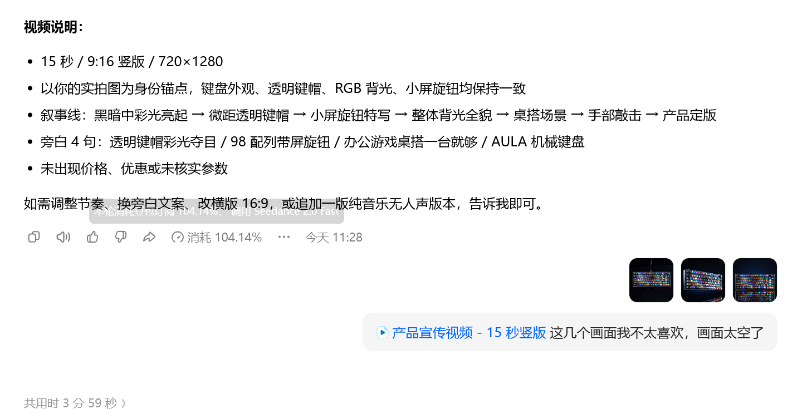
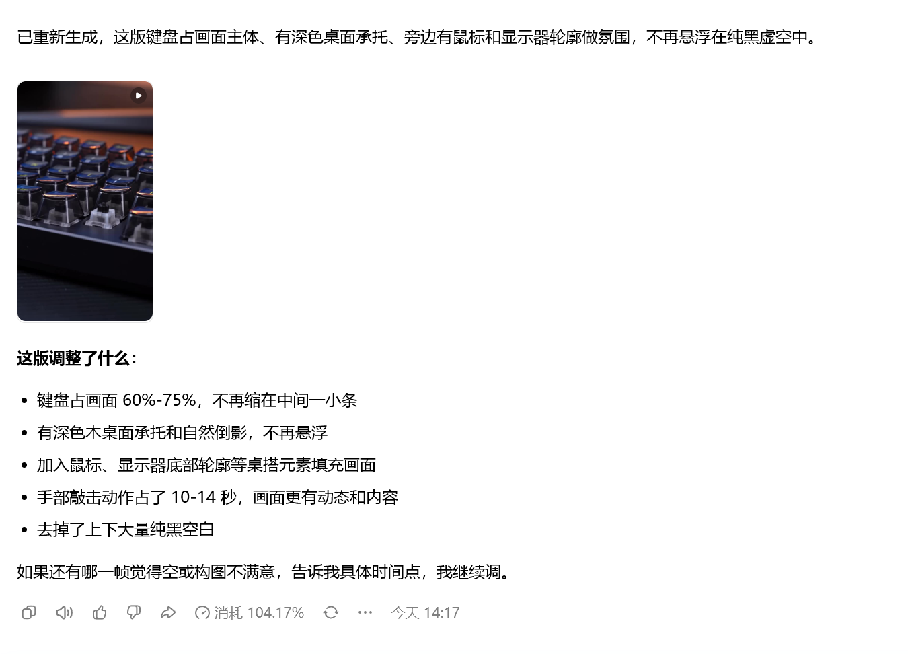

# 产品宣传视频实测记录

日期：2026-10-17。用户提供3张操作截图及一份「饱满版」MP4。首版未取得视频文件，首版判断仅依据截图与用户反馈；饱满版已读取文件并抽帧检查，未独立试听音轨。原文件保留不改。

## 首轮输入和结果

实际输入前的标签为「创意视频」。截图中的文字如下，不能用优化后的提示词替换这次实际输入。

```text
基于这把键盘的原始实拍图和上面的商品素材，制作一条15秒、9:16的产品宣传视频，突出键盘外观和彩色背光。商品外观以原始实拍图为准，未核实的规格、功能和优惠不要使用，先给我确认方案。
```

首轮界面显示用时4分29秒、消耗104.14%，回复时间11:28。截图提示信息提到Seedance 2.0 Fast，但本次未取得完整模型配置或运行日志。百分比超过100%，额度基数与显示口径未确认，仅记录原值，不换算现金、剩余额度或可生产数量。

首轮说明称输出15秒、9:16、720×1280，有透明键帽、旋钮、桌搭和手部敲击等镜头，并声称外观一致。旁白说明里仍写有「98配列」，商品规格并未由用户核实。现有截图没有单独的方案确认页，不能写成已经验证「先确认分镜再生成」或「没有任何确认步骤」。

## 用户修改与第二轮

用户选取三个画面并反馈，实际原话如下。

```text
这几个画面我不太喜欢，画面太空了
```

第二轮界面显示用时3分59秒、消耗104.17%，回复时间14:17。两轮回复时间之间包含作者操作和等待等未知间隔，不当作全部制作耗时；两轮界面用时与百分比分开记录。修改后豆包称增加桌面承托、鼠标和显示器轮廓，扩大键盘主体，加入敲击镜头。「键盘占60%—75%」仅为模型自述，未测量。

用户提交的文件已另存为[产品宣传视频饱满版](产品宣传视频-饱满版.mp4)。用户随后表示「我准备在改一下」，继而说明「开头的中文和旁白有问题，最后不要让他提品牌」。据此记录为继续修开头中文与旁白、结尾取消品牌提及，不将当前文件当最终采用版。用户未说明错误字词或原音轨的具体问题，助手也未独立试听，不补造诊断。

## 文件检查与抽帧观察

读取到的容器时长约15.072秒，画面720×1280，比例9:16，24帧/秒，H.264视频，包含AAC双声道音轨。媒体信息保存在[媒体信息](宣传视频媒体信息.json)。确认存在音轨不代表已听过旁白或音乐。

在0、0.5、1及2至14秒、14.5秒共17个时间点抽帧，并查看6秒与11秒原尺寸帧。抽帧只能支持对应时间点的画面描述，不能替代全程动作连续性和口型声音检查。

- 开头抽帧是键帽近景，可见彩光点亮和桌面背景，主体不再只是大块黑底中的一小条键盘。
- 约3秒和13—14.5秒为桌面上的键盘展示，可见鼠标、显示器边缘等环境元素。
- 约5—6秒为透明感键帽、屏幕与旋钮的微距，约9秒可见手放到键盘上，10—12秒有手指接触按键的画面；未据此确认每次敲击的运动与按键结构准确。
- 约6秒的品牌附近字母有变形，部分键帽字符出现重绘或不清晰；视频中的屏幕内容与原始照片也有变化。因此保留「能制作多镜头宣传片」与「商品细节仍需核对」两个观察，不采信模型自报外观完全一致。
- 抽帧可见「透明键帽·彩光夺目」和结尾「AULA机械键盘」等文字。首轮旁白中「98配列」是否仍出现在第二版音轨，尚未试听确认。



原尺寸细节帧另存[1秒](宣传视频抽帧-01秒.jpg)、[6秒](宣传视频抽帧-06秒.jpg)、[11秒](宣传视频抽帧-11秒.jpg)、[14秒](宣传视频抽帧-14秒.jpg)。这些是检查用抽帧，不是另一次生成结果。

## 开头字幕与旁白修改建议（待执行）

以下是依据用户新要求拟的补充提示词，包含建议替换文案。尚未收到用户实际发送截图或第三轮成片，不当作已执行记录。只处理字幕、旁白与结尾品牌提及，其他镜头和音乐沿用已有版本。

```text
开头字幕改成「让桌面亮起来」，中文要清楚、没有错字。旁白改成「透明键帽，彩色背光。给你的桌面，换一种氛围。」语气自然一点。结尾不要念品牌名，也不要加品牌字幕，用键盘展示自然收尾。其他镜头和音乐保持不变。
```

品牌字幕和口播的取消不等同修改商品本身标识；微距里商品文字重绘仍是已观察到的细节问题，本轮未承诺它已修复。

## 下一步

保留首版画面太空的反馈、第二轮结果与细节问题。新修改目标已经明确，等待实际输入和新成片，核对开头中文、替换旁白及结尾是否仍出现品牌字幕或口播；不记录第三轮成功。人物出镜带货视频仍待执行，留在宣传片修改后的后续任务；不把宣传片中的手部镜头写成已完成人物带货案例。

## 操作截图






