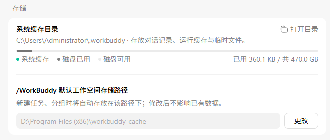

最近，用 WorkBuddy 的人真是越来越多了，连地铁广告牌上都挂上了一整排「WorkBuddy 我帮你」。

连我家孩子小伙伴的家长，也来打听 WorkBuddy 怎么用。

和朋友聊下来，我发现不少人还停留在「装好就用」这一步。打开对话框，交代任务，至于设置里有哪些选项，很少回头看。

这样当然也能用。但如果有些要求每次都得重新交代，或者用着用着发现 C 盘越来越满，就值得回头看看设置了。

这篇聊聊 WorkBuddy 值得了解的七处设置。你可以按自己的情况调整，让它更适合你的工作习惯，用起来更顺手。

## 先看存储路径，别让 C 盘越用越满

我的电脑原来只有一块 512GB 的硬盘，C 盘更是只有可怜的 125GB。用了 WorkBuddy 一段时间后，C 盘动不动就满，搞得我隔几天就得清理一次。

后来，我还赶上硬盘涨价，忍痛加了一块 1TB 的固态硬盘，真是肝疼！

折腾了一阵才发现，我虽然把 WorkBuddy 安装到了 D 盘，但它的系统缓存目录还在 C 盘。

程序装在哪里，不代表它运行时产生的数据就都存在哪里。下面这张图是加盘之后截的，和前面说的旧硬盘配置不同。

这里要分清两个位置。

上面的「系统缓存目录」，存放对话记录、运行缓存和临时文件。我这张截图里，它还在 C 盘的用户目录下。

下面的「默认工作空间存储路径」，用来保存新任务、分组里的文件。旁边的「更改」按钮改的是这个位置，界面也写明了，修改后不影响已有数据。

**改工作空间的路径，不会把已有的系统缓存一起搬走。**

如果你刚开始用 Windows 版 WorkBuddy，可以先检查默认工作空间的位置，按需要选到空间充足的盘里。

如果已经用了很久，想把现有的系统缓存和数据一起迁走，就要另外处理。可以先让 WorkBuddy 查清目录和占用，再给出迁移方案。里面有对话记录，别把整个目录当成临时文件直接清空。

迁移前做好备份，迁移后再检查旧任务能否打开、重启后新数据写到了哪里。确认能正常使用，再处理原位置保留的备份。
