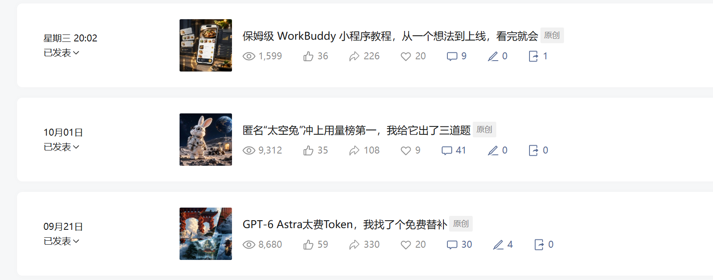
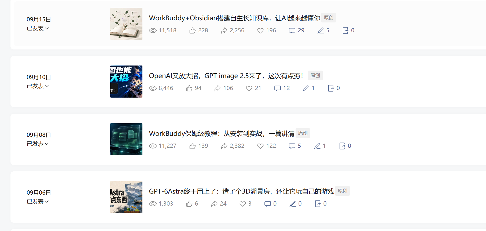

# 公众号商单实施复盘

## 当前阶段与证据

### 当前更新（2026-10-26）

本节依据本次用户口述和聊天附件，不新增或修改 raw 文件；下方2026-10-16数据保留为历史快照，不代表当前全部进展。此次商务截图未复制进仓库，以下只保留业务阶段与必要条款，不保存联系人身份。

- 用户确认自己是新号、新手，已输出十几篇文章，大部分加热，阅读基本稳定在8000以上。这是用户对整体表现的描述，不表示每篇均超过8000，也不证明自然阅读稳定。
- 用户确认已有三个合作方主动联系，最终均未成交。主动联系是入站商务信号，但发现渠道未知，不能归因于某篇内容或加热。部分对接人使用“提报”表述，可能是媒介或代理，不直接登记为品牌直客。
- 用户说明首次报价希望保守一些，用于测试价格；不是认定账号只能按该价格出售。报价、提报价与成交价分别记录。

| 线索 | 截图支持的进展 | 当前边界 |
| --- | --- | --- |
| 百度文库 | 原创图文头条报价5000元；对接人询问4500元能否提报，用户同意；后续跟进得到“暂时没有反馈” | 未见品牌接受价格、正式排期或成交；4500元是同意用于提报的价格 |
| 稿定AI设计 | 对方主动发起商务合作，用户回复问候 | 截图未见具体需求、报价或拒绝，停止原因未知 |
| 未上线AI项目 | 用户报价5000元，填写粉丝1200、预估商单阅读8000、近30日平均阅读8323，并表示可实测Agent；对方表示先提报 | 数值是当时申报口径，不代替后台独立核验；未见最终选择与成交 |

**最新阶段判断**：已有内容样板、付费分发与主动合作线索；截图中两条进入提报沟通，一条停在初步接触。用户已说明均未成交，但没有证据证明失单是报价过高、阅读不足或粉丝不足导致。不能将“愿意提报”记作价格获市场验证。

### 本轮数据观察与经营建议

新截图中，WorkBuddy入门教程为11382阅读、分享箭头2410；知识库为11652阅读、分享箭头2275；小程序为9221阅读、分享箭头1701。相近阅读的DeepSeek实测为8890阅读、分享箭头126，太空兔为9350阅读、分享箭头109。分享箭头不当作去重人数；投放、受众及累积时长未对齐，仅支持优先研究教程与工作流案例，不证明因果或收益。

以下是助手建议，尚未验证，也不表示用户已调整投放：

- 不以“每篇补到8000”作为续投理由；保留选择性、有预算上限的加热，不建议依据当前证据全面停投或加码。
- 新文先留自然观察窗口，适当保留不加热样本；区分付费与自然来源，无法区分的明确记为混合。旧文不为维持数字无条件追加。
- 先跟进提报是否完成、项目是否继续、筛选原因，再决定调整内容、价格或分发；原因未知时不自动降价或追加投流。
- 4500—5000元仅为此次试报价记录及后续可考虑保留的试价口径，不是已验证市场价。比较相近交付，优惠要明确范围，不默认增加免费分发、授权或无限改稿。
- 百度文库填写过“可保阅读5000”，另一个项目填写“预估商单阅读8000”。预估与保底不是同一责任；如需保底，明确周期、费用承担和未达标处理，核算制作、推广、税费及分成后再承诺。
- 尚缺逐篇加热支出、来源、关注归因、当前现金预算及失单原因，不能计算投流回报或制定具体投放金额。

选题卡点与定位承接见 [[topics/公众号每日选题决策]]；方法差异见 [[topics/AI公众号商单商业闭环]]。

### 历史快照（2026-10-16）

2026-10-16，用户确认已按 [[topics/AI公众号商单商业闭环]] 开始实施，`raw/article/程序员拾梦/` 的 **7 篇文章均已发布**，并提供两张后台截图。用户同时确认：**7 篇都使用了加热，账号当前 962 粉丝，已有百度文库图文合作询价，且由客户主动联系。**后续商务截图显示已报价、调整并由对接人准备提报；尚未见最终合作确认、履约或到账证据。

目前应记为「已有实测内容与发布样本、正在付费分发验证、出现首条询价并进入提报」，商业闭环仍待验证。不能继续按「零内容、尚未发布、没有读者数据」安排工作，也不能因为有询价就记成交。

本页文章内容依据上列 raw 文件，发布状态、粉丝、投流情况与商务进展依据本次用户确认；后台数值由下方截图逐项抄录。两张后台截图已保存在 `wiki/assets/公众号商单实施数据/`。具体投流金额、议价及私人聊天截图保留在本机复盘文件，不随知识库提交。

## 七篇文章的后台快照

收到截图日期为 2026-10-16，不等于后台的统一统计截止时间。原图未提供指标文字说明，按图标记录：眼睛图标按阅读展示，其余分别标为拇指、分享箭头、心形、对话气泡；分享箭头计数的次数/人数及转发渠道口径待确认，不能当作唯一转发人数。未解释的笔形和末列图标暂不纳入分析。

| 文章简称 | 截图显示发布时间 | 阅读 | 拇指图标 | 分享箭头 | 心形图标 | 对话气泡 |
| --- | --- | ---: | ---: | ---: | ---: | ---: |
| WorkBuddy 小程序教程 | 星期三 20:02，具体日期待确认 | 1599 | 36 | 226 | 20 | 9 |
| 太空兔三道题 | 10月01日 | 9312 | 35 | 108 | 9 | 41 |
| 免费替补模型 | 09月21日 | 8680 | 59 | 330 | 20 | 30 |
| WorkBuddy + Obsidian 知识库 | 09月15日 | 11518 | 228 | 2256 | 196 | 29 |
| GPT image 2.5 | 09月10日 | 8446 | 94 | 106 | 21 | 12 |
| WorkBuddy 入门教程 | 09月08日 | 11227 | 139 | 2382 | 122 | 5 |
| GPT-6 Astra 湖景房与游戏 | 09月06日 | 1303 | 6 | 24 | 3 | 0 |

- 7 篇累计阅读合计 **52085**，中位数 **8680**；是不同文章、不同累积时长的阅读计数，不能写成去重读者数或「篇篇稳定近万」。
- 两篇较早的 WorkBuddy 知识库/入门教程合计阅读 **22745**，占全体约 **43.7%**；分享箭头合计 **4638**，占全体该图标计数 **5432** 的约 **85.4%**。
- 上述集中度支持优先研究这两篇、将其作为商务代表作候选；只凭两个样本不能确定教程一定优于测评，更不能排除投流、曝光时长和人群差异。
- 最新小程序文仅有当前快照，不能因 1599 阅读判断选题失败。后续用各篇发布后相同的 24 小时、72 小时或 7 天窗口比较，历史窗口取不到就标缺失，不用当前累计值代替。

## 内容资产已具备什么

| 内容组 | 已有作品与案例 | 可向客户展示的能力 | 还需补什么 |
| --- | --- | --- | --- |
| WorkBuddy 教程与工作流 | 安装到个人工作台；Obsidian 知识库；点餐小程序及管理员功能 | 把工具变成可理解、可跟做的任务与成果 | 统一窗口表现、读者画像、实际工时、可复用的证据包 |
| 模型与 Coding 实测 | 湖景房与游戏；太空兔基地、旅游网页与沙盒；免费替补的多模态与编程尝试 | 设计任务、展示效果、记录失败与修改 | 产品版本、测试成本、首稿与返工边界 |
| 图像编辑实测 | 草图生图与连续修改 | 用可见结果解释具体功能 | 对品牌目标的适配说明和同窗口反馈 |

本表是对已有内容资产的盘点，不将它们登记为已合作广告，也不为所有案例补做完整来源拆解。原稿中的个人体验不自动证明每项技术机制或平台能力，后续商务引用仍需按 [[topics/证据与边界库]] 检查。

## 当前商务进展

- 已有一个百度文库微信公众号原创图文合作询价，经过报价调整，对接人表示先提报。用户确认由客户主动联系，属于入站询价，不是作者主动开发所得；用户说明本次目的为初期试价。
- 这说明账号已出现被潜在客户发现并进入商务沟通的信号；对方通过哪篇文章、推广、介绍或其他渠道找到账号尚未确认，不能归因给某一篇内容或某次加热。
- 「愿意提报」说明线索进入客户筛选环节，不等于客户接受价格、订单成立或收入到账。
- 不把当前粉丝少直接解释为只能低价；报价要同时看受众、样板、制作工作量、推广投入、改稿与分发范围。当前也没有证据证明已找到稳定成交价。
- 本轮需要复核原报价中承诺的阅读保底、额外平台分发、留存时间和完整成本。不同文章的累计阅读不足以证明未来商稿可保证同样结果。
- 议价明细和可发送的跟进草稿保存在本机文件；本次没有向客户发送任何消息。

## 接下来一周的执行重点

以下是依据当前进展调整的建议，不是新增收益承诺。

1. **完善首条线索的记录**：标为「已报价，对接人表示将提报；待确认进展」，记录上次沟通时间、预算与交付待确认项、下一次跟进；未见提交回执，不能断定已完成提报。最终排期、产品需求、修改范围、验收与付款未明确前，不视为已成交。
2. **把 7 篇变成可比较的数据表**：补每篇累计加热投入、加热起止、投放目标、可分辨的付费与自然来源、可归因关注、真实制作工时。用户已确认全部用过加热，缺来源拆分时统一记「自然与付费混合」。
3. **做一页合作介绍**：用知识库教程和入门教程展示成熟样板，小程序展示新的任务交付能力；如实列近期全部文章的表现范围与推广构成，注明账号当前 962 粉丝，不只展示两篇高阅读。
4. **延续已验证有反馈的任务方向**：下一篇优先从读者具体问题出发延伸既有场景。保留新文同窗口观察，不因当下累计阅读低就换方向；试价与内容更新并行。
5. **核算现金与试价结果**：投流金额先按用户口述区间保存在本机账本，逐篇用实际账单确认；询价、报价、提报、成交、到账分开记录。某笔潜在报价不能抵消已经支出的推广费。

## 暂时不能从这些数据得出的结论

- 不知道初始粉丝数、每篇新增关注和归因情况，不能用总投流费用除以 962 当作获粉成本。
- 全部文章均有加热，不能把当前阅读写成自然流量能力；阅读和当前总粉丝也不能直接算关注转化率。
- 缺少付费曝光、点击及关注数据，不能把投入除以混合阅读后称为纯付费阅读成本或投流回报率。
- 尚无确认成交与回款证据，不能计算已实现商单收入、实际利润或复购率。
- 7 篇文章的累计表现支持已有内容与传播反馈，不足以认定完整商业闭环已跑通，或某种写作风格已经被因果验证。

## 相关页面

- [[topics/AI公众号商单商业闭环]]
- [[topics/公众号内容生产线]]
- [[entities/程序员拾梦]]
- [[topics/太空兔三道题实测]]
- [[sources/拾梦七篇已发布文章内容蒸馏]]：补七篇的案例设计、修改路径与内容方法；不从累计阅读反推写法效果。
